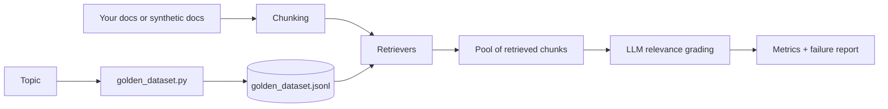

# Golden Dataset + RAG Retrieval Evaluation

Build a **golden Q&A dataset** for any  AI topic, then use it to **measure and improve retrieval** in a RAG (Retrieval-Augmented Generation) pipeline.

The project has two tools:

| Tool | What it does |
|------|--------------|
| `golden_dataset.py` | Uses an LLM (via Groq) to generate, deduplicate and verify question/answer pairs with key facts on any topic. |
| `retrieval_eval_final.py` | Compares four retrievers (BM25, dense embeddings, hybrid fusion, reranking) against your golden dataset and reports Hit, Precision, Recall, MRR and nDCG. |

---

## Table of contents

1. [Why this exists](#why-this-exists)
2. [How it works](#how-it-works)
3. [Project structure](#project-structure)
4. [Setup](#setup)
5. [Quick start](#quick-start)
6. [Tool 1: golden dataset generator](#tool-1-golden-dataset-generator)
7. [Tool 2: retrieval evaluation](#tool-2-retrieval-evaluation)
8. [The retrievers](#the-retrievers)
9. [Metrics explained](#metrics-explained)
10. [How to read your results](#how-to-read-your-results)
11. [Tuning guide](#tuning-guide)
12. [Using your own documents](#using-your-own-documents)
13. [Output files](#output-files)
14. [Limitations](#limitations)
15. [Troubleshooting](#troubleshooting)
16. [Security notes](#security-notes)
17. [Roadmap](#roadmap)
18. [License](#license)

---

## Why this exists

A RAG system is only as good as its retrieval step. If the right passage never reaches the LLM, no prompt can fix the answer. But "does retrieval work?" is hard to answer without a test set.

This project gives you:

- A **repeatable test set** (the golden dataset) with questions, reference answers and key facts.
- A **fair comparison** of retrieval strategies on the same data and the same relevance labels.
- **Concrete numbers** to guide choices such as chunk size, embedding model and whether a reranker is worth the cost.

---

## How it works



**Golden dataset pipeline**

1. **Generate:** the LLM writes Q&A pairs at easy, medium and hard difficulty, across five question types (factual, conceptual, comparison, applied, edge case).
2. **Deduplicate:** near-identical questions are removed.
3. **Verify:** a second LLM pass scores each pair and drops weak ones.
4. **Export:** results are saved as `.jsonl` and `.csv`.

**Retrieval evaluation pipeline**

1. **Chunk** the corpus with sentence-aware splitting and overlap.
2. **Retrieve** the top 10 chunks per question with each retriever.
3. **Pool** all retrieved chunks for each question.
4. **Grade** each pooled chunk with an LLM against the question, reference answer and key facts (0 = irrelevant, 1 = related, 2 = contains the answer). Grades are cached.
5. **Score** every retriever using those grades.
6. **Report** a comparison table and a CSV of the best retriever's misses.

---

## Project structure

```
.
├── golden_dataset.py          # Generate the golden Q&A dataset
├── retrieval_eval_final.py    # Evaluate and compare retrievers
├── golden_dataset.jsonl       # Example generated dataset
├── golden_dataset.csv         # Same dataset in CSV form
├── docs_synth/                # Example synthetic knowledge base
├── requirements.txt           # Python dependencies
├── LICENSE
└── README.md
```

Files created when you run the tools (ignored by Git):

```
judgments.json                 # Cached LLM relevance grades
retrieval_results.json         # Scores for every retriever
retrieval_failures.csv         # Questions the best retriever missed
.env                           # Your API key (never commit this)
```

---

## Setup

**Requirements:** Python 3.10 or newer and a free [Groq](https://console.groq.com) API key.

```bash
# 1. Clone the repo
git clone https://github.com/Shreyansh-awasthi/rag-retrieval-eval.git
cd rag-retrieval-eval

# 2. Create and activate a virtual environment
python -m venv venv
# Windows (PowerShell):
.\venv\Scripts\Activate.ps1
# macOS / Linux:
source venv/bin/activate

# 3. Install dependencies
pip install -r requirements.txt
```

**Add your API key.** Create a file named `.env` in the project folder containing exactly one line:

```
GROQ_API_KEY=your_key_here
```

No quotes, no spaces around `=`. The file is listed in `.gitignore`, so it won't be committed.

The first retrieval run downloads the embedding and reranker models from Hugging Face. This takes a few minutes and needs internet access.

---

## Quick start

```bash
# 1. Generate a golden dataset (random AI topic if none given)
python golden_dataset.py --topic "Retrieval-Augmented Generation" --n 30

# 2. Evaluate retrieval against it
python retrieval_eval_final.py

# 3. Try a stronger embedding model
python retrieval_eval_final.py --embedder BAAI/bge-small-en-v1.5
```

---

## Tool 1: golden dataset generator

```bash
python golden_dataset.py --topic "Prompt engineering" --n 30 --out golden_dataset
```

| Option | Default | Description |
|--------|---------|-------------|
| `--topic` | random AI topic | Any subject, for example `"Fine-tuning and LoRA"` |
| `--n` | `30` | Target number of final Q&A pairs |
| `--out` | `golden_dataset` | Output file prefix |

Run `python golden_dataset.py --help` for the full list in your version.

**Output format** (one JSON object per line in `golden_dataset.jsonl`):

```json
{
  "id": "prompt_engineering_001",
  "topic": "Prompt engineering",
  "type": "conceptual",
  "difficulty": "medium",
  "question": "Why does few-shot prompting improve output consistency?",
  "answer": "Examples show the model the expected format and style, which narrows the range of likely outputs.",
  "key_facts": ["Examples demonstrate format", "Narrows output distribution"],
  "quality_score": 5
}
```

The model name is set by the `MODEL` constant near the top of the file. Change it if Groq retires a model.

---

## Tool 2: retrieval evaluation

```bash
python retrieval_eval_final.py \
  --golden golden_dataset.jsonl \
  --docs docs \
  --embedder BAAI/bge-small-en-v1.5 \
  --chunk-size 120 \
  --overlap 30
```

| Option | Default | Description |
|--------|---------|-------------|
| `--golden` | `golden_dataset.jsonl` | Path to your golden dataset (`.jsonl` or `.csv`) |
| `--docs` | `docs` | Folder of `.txt` / `.md` files to retrieve from |
| `--chunk-size` | `120` | Words per chunk |
| `--overlap` | `30` | Words shared between neighbouring chunks |
| `--limit` | all | Use only the first N golden questions |
| `--embedder` | `all-MiniLM-L6-v2` | Any sentence-transformers model, for example `BAAI/bge-small-en-v1.5` or `BAAI/bge-base-en-v1.5` |
| `--hyde` | off | Also test HyDE query expansion (extra LLM calls) |

If the `docs` folder is missing or empty, the script writes a synthetic knowledge base from your golden questions into `docs_synth/`. This is useful to check that the pipeline works, but see [Limitations](#limitations).

---

## The retrievers

| Retriever | Idea | Strength | Weakness |
|-----------|------|----------|----------|
| **BM25** | Keyword matching with term-frequency weighting | Fast, exact on shared vocabulary | Misses paraphrases |
| **Dense** | Embeds query and chunks, ranks by cosine similarity | Understands meaning | Can miss exact terms and names |
| **Hybrid (RRF)** | Fuses BM25 and Dense rankings with Reciprocal Rank Fusion | Combines both strengths | Slightly more compute |
| **Hybrid + Rerank** | Retrieves 20 candidates, then a cross-encoder re-scores each (question, chunk) pair | Best ordering and recall | Slowest, needs a model download |
| **+ HyDE** *(optional)* | LLM writes a hypothetical answer that is added to the query | Helps with short or vague questions | One extra LLM call per query |

---

## Metrics explained

All metrics are averaged over questions that have at least one relevant chunk in the corpus.

| Metric | Meaning |
|--------|---------|
| **Hit@k** | Share of questions where at least one relevant chunk is in the top k. |
| **Precision@k** | Share of the top k chunks that are relevant. Capped by how many relevant chunks exist, so a question with 2 relevant chunks can never exceed 0.4 at k=5. |
| **Recall@k** | Share of all known relevant chunks found in the top k. |
| **MRR** | Mean of 1 / (rank of the first relevant chunk). Rewards putting the answer first. |
| **nDCG@k** | Rank-aware score using the 0/1/2 grades. Rewards putting the best chunks at the top. |

A chunk counts as **relevant** for Hit, Precision, Recall and MRR when its grade is 2. nDCG uses the full 0, 1, 2 grades.

---

## How to read your results

| You see | It probably means | What to try |
|---------|-------------------|-------------|
| Low hit@5 for every retriever | Documents don't cover the questions, or chunks are badly sized | Add documents, change `--chunk-size` |
| Dense far better than BM25 | Questions are paraphrased relative to the text | Keep embeddings in the mix |
| BM25 better than Dense | Questions share exact terms with the text | Keep BM25 in a hybrid setup |
| High recall@10 but low precision@5 | Relevant chunks are retrieved but ranked low | Add or strengthen the reranker |
| Reranker doesn't help | Chunks too small for the cross-encoder, or retrieval is already near the ceiling | Use larger chunks, or skip reranking |
| Some questions skipped | No chunk in the corpus answers them | Add documents covering those questions |

---

## Tuning guide

Change one setting at a time and compare **nDCG@5**, **recall@10** and **hit@1**.

```bash
# Smaller, tighter chunks
python retrieval_eval_final.py --chunk-size 80 --overlap 20

# Larger chunks with more context
python retrieval_eval_final.py --chunk-size 200 --overlap 50

# Stronger embeddings
python retrieval_eval_final.py --embedder BAAI/bge-base-en-v1.5

# Test query expansion
python retrieval_eval_final.py --hyde
```

**To improve precision**, the biggest lever is usually the reranker. Replace the cross-encoder model name (`cross-encoder/ms-marco-MiniLM-L-6-v2`) in the `Rerank` class with `BAAI/bge-reranker-base`.

**Keep the grader fixed.** Relevance grades are cached in `judgments.json` by question and chunk text. If you switch the LLM grader between runs, delete `judgments.json` first so every run is graded by the same model.

**A common production setup:** hybrid retrieval, about 20 candidates, rerank, then pass the top 5 to 10 chunks to your LLM.

---

## Using your own documents

1. Create a `docs` folder next to the scripts.
2. Add `.txt` or `.md` files (subfolders are fine).
3. Make sure your golden questions can actually be answered from those documents.
4. Run `python retrieval_eval_final.py`.

For a trustworthy evaluation, use real documents, at least 50 golden questions, and questions that paraphrase the source instead of copying its wording.

---

## Output files

| File | Contents |
|------|----------|
| `retrieval_results.json` | All metric values per retriever |
| `retrieval_failures.csv` | Questions where the best retriever missed rank 1: the question, key facts, top retrieved chunk and its grade, and a chunk that was actually relevant |
| `judgments.json` | Cached LLM grades (re-runs reuse these and cost nothing) |

Open `retrieval_failures.csv` after each run. Reading a handful of misses tells you more than the averages: you'll see whether the cause is chunk boundaries, missing documents or a grading mistake.

---

## Limitations

- **LLM grading is imperfect.** Relevance labels come from a model and carry some noise. Spot-check them.
- **Pooled relevance.** Only chunks retrieved by at least one retriever get graded, so recall is relative to the pool, not to every chunk in the corpus.
- **Small test sets.** With about 30 questions, differences under roughly 0.03 are within noise.
- **Synthetic corpus bias.** The generated `docs_synth` articles were written to contain the answers, which makes retrieval look easier than it will be on real documents.
- **Same-family bias.** Questions, articles and grades all come from LLMs, so results may not transfer perfectly to human-written queries.
- **Text only.** PDFs, tables and images are not parsed. Convert them to `.txt` or `.md` first.

---

## Troubleshooting

| Problem | Fix |
|---------|-----|
| `GROQ_API_KEY not found` | Create `.env` with `GROQ_API_KEY=your_key` in the project folder. Check it isn't saved as `.env.txt`. |
| `model_not_found` (404) | The model was retired or you lack access. List available models and update the `MODEL` constant: `python -c "from dotenv import load_dotenv; load_dotenv(); from groq import Groq; [print(m.id) for m in Groq().models.list().data]"` |
| Script runs but prints nothing | The file on disk is empty. Check its size, then re-save or re-download it. |
| `ModuleNotFoundError` | Activate the virtual environment and run `pip install -r requirements.txt`. |
| Rate-limit errors | The scripts retry automatically. Lower `--n` or `--limit`, or wait a minute. |
| First run is slow | Embedding and reranker models are downloading. Later runs use the cache. |
| Different chunk size makes grading slow again | Grades are cached per chunk text. New chunks need new grades. |
| `git` not recognized (Windows) | Open a new terminal after installing Git, or restart. |

---

## Security notes

- **Never commit your API key.** `.env` is in `.gitignore`. Before pushing, run `git ls-files` and confirm `.env` isn't listed.
- If a key is ever exposed (committed, pasted in chat or a screenshot), **revoke it** in the Groq console and create a new one. Deleting a file later does not remove a key from Git history.

---

## Roadmap

- [ ] Add an end-to-end answer evaluation (faithfulness and answer correctness)
- [ ] Support PDF and HTML ingestion
- [ ] Plug in external vector databases (Chroma, FAISS, Qdrant)
- [ ] Export golden datasets to DeepEval and Ragas formats
- [ ] Add multi-hop and unanswerable question types
- [ ] Add confidence intervals so small differences are flagged as noise

---

## License

See the [LICENSE](LICENSE) file.

---

## Author

Built by [Shreyansh Awasthi](https://github.com/Shreyansh-awasthi).
